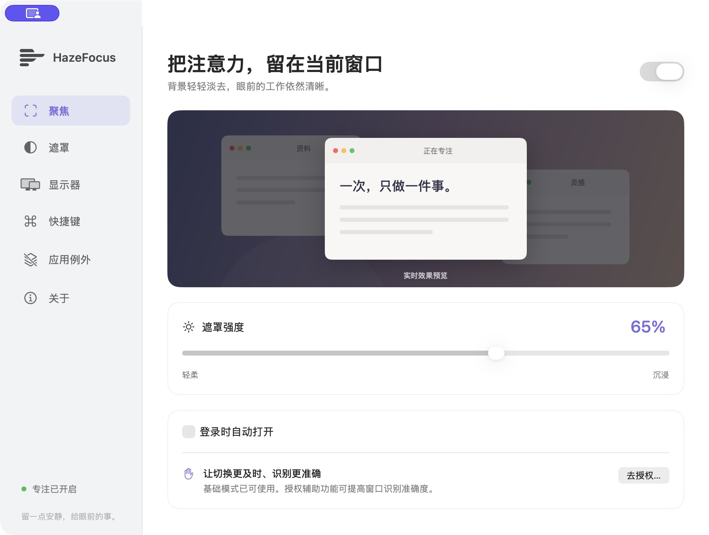
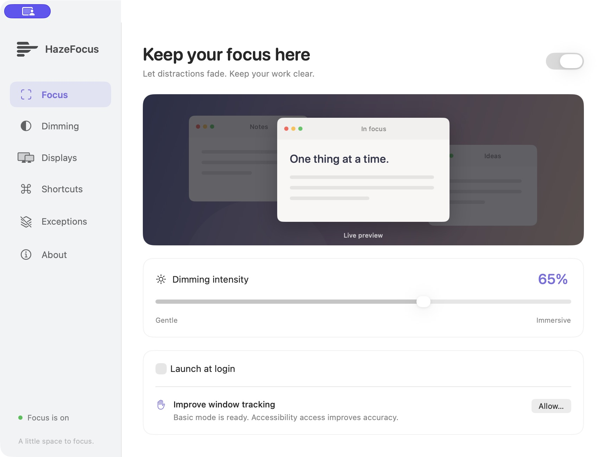
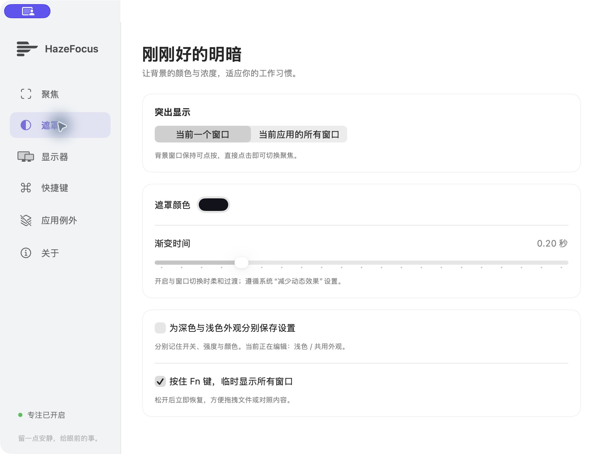
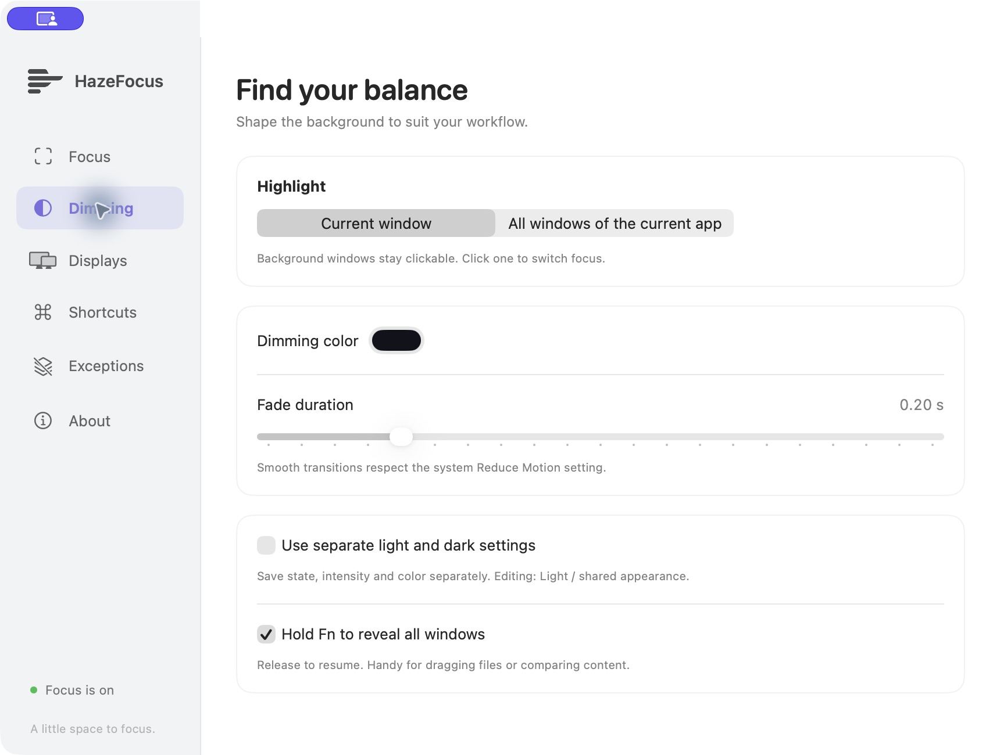

# HazeFocus

参照 HazeOver 官网、Mac App Store 和用户提供的 1.9.9 安装包，独立实现的原生 macOS 专注工具。支持中文和英文界面（跟随 macOS 的每 App 语言偏好）。SwiftUI 设置界面、AppKit 遮罩、Core Graphics 窗口列表、可选 Accessibility 精确追踪。支持 macOS 13+，构建 Universal 版本可运行于 Apple Silicon 和 Intel。

## 使用

从[产品网站](https://luchuangao.github.io/#product-hazefocus)下载 [HazeFocus 1.0.2](https://luchuangao.github.io/assets/HazeFocus-1.0.2.dmg)，或构建后打开 `artifacts/HazeFocus-1.0.2.dmg`，将应用拖入 Applications。也可直接打开 `artifacts/HazeFocus.app`。首次启动打开设置，关闭设置后常驻菜单栏。

- 自动压暗背景，突出当前窗口或当前应用的所有窗口。
- 强度和颜色可调；窗口切换渐变；跟随系统减少动态效果。
- 深浅外观分别保存开关、强度和颜色。
- 当前窗口聚焦或每屏保留一个窗口，逐屏开关，按显示器 UUID 保存。
- 应用例外、登录时启动、Fn 按住临时取消遮罩。
- ⌃⌥⌘H 全局快捷键可重录，双击/Option 点按图标开关，滚动调整强度。
- AppleScript 读写开关和强度；URL Scheme 可接入快捷指令。
- 无账号、遥测、网络或录屏需求；辅助功能权限可选。

详细操作见 [使用说明](docs/使用说明.txt)。

## 构建

安装 Xcode 或支持 Swift 5.9+ 的命令行工具，无第三方依赖。

```sh
swift test
bash scripts/build.sh             # 本机架构 .app
bash scripts/build.sh universal   # arm64 + x86_64 .app
bash scripts/package.sh           # Universal .app、DMG、ZIP、SHA-256
open artifacts/HazeFocus.app
```

用 Xcode 打开 `Package.swift` 可编辑源码。直接运行 Swift Package 二进制不具有完整应用 Bundle，URL Scheme、脚本字典和登录项应通过打包后的 `.app` 验证。

正式发行的 Developer ID 签名、Apple 公证和票据验证流程见 [公证说明](docs/NOTARIZATION.md)。凭据保存在本机钥匙串，仓库不保存密码和私钥。

```sh
artifacts/HazeFocus.app/Contents/MacOS/HazeFocus --diagnostics
artifacts/HazeFocus.app/Contents/MacOS/HazeFocus --render-check
open artifacts/HazeFocus.app --args --settings
```

`--preview` 仅展示设置，不启动桌面遮罩，供界面调试使用。

## 自动化

```applescript
tell application "HazeFocus"
    set intensity to 70
    set enabled to true
    get enabled
end tell
```

快捷指令使用“打开 URL”：`hazefocus://on`、`hazefocus://off`、`hazefocus://toggle`、`hazefocus://intensity?value=70`、`hazefocus://settings`。强度参数为 0–100；非法值被忽略。

## 结构与边界

`FocusCore` 负责坐标转换、窗口选择和 URL 参数验证。`DimmerEngine` 使用每屏一个不激活、鼠标穿透的透明面板。绘制按实际窗口前后顺序处理，避免多窗口重叠时的遮罩孔洞反转。AX 通知即时刷新，窗口列表以低频轮询兜底。窗口拖动更新位置时不做过渡，焦点改变时渐变。

当前未实现原应用的原生 Focus Filters、独立 App Intents、Touch Bar和自动更新；快捷指令经 URL 控制。未使用私有 WindowServer API，因此 Mission Control、台前调度、特殊异形窗口和系统切换动画可能短暂错位。真实多显示器、Intel 硬件和旧版 macOS 尚需实机验证。具体已验证范围见 [验证记录](docs/VALIDATION.md)。

发布包使用临时签名，尚未进行 Developer ID 签名和公证。后续公开分发前可用自己的开发者证书签名并提交公证。重新编译后签名标识可能变化，已有辅助功能授权如失效需重新授予。

## 参考依据

- [HazeOver 官网](https://hazeover.com/)
- [官方帮助](https://hazeover.com/help.html)
- [官方自动化说明](https://hazeover.com/automation.html)
- [原版 Mac App Store](https://apps.apple.com/us/app/hazeover-distraction-dimmer/id430798174?mt=12)
- 本地安装包静态分析见 [研究记录](docs/RESEARCH.md)。

本项目使用独立名称、图标和代码。HazeOver 的名称和原产品素材属于原作者。

## Screenshots / 界面截图

| 中文 | English |
| --- | --- |
|  |  |
|  |  |

## English

HazeFocus is a lightweight native macOS utility that dims background windows and keeps the active window clear. It supports macOS 13+, Apple Silicon and Intel, and Chinese and English interfaces. Adjust intensity and color, choose a single window or all windows of the current app, configure multiple displays, exclude apps, and toggle dimming with a customizable shortcut. Hold Fn to reveal other windows temporarily. Basic mode does not require Accessibility access; granting access improves tracking. No Screen Recording access, account, telemetry or network service is required.

[Download for Mac](https://luchuangao.github.io/assets/HazeFocus-1.0.2.dmg) · [Product website](https://luchuangao.github.io/#product-hazefocus)

Open the DMG and drag HazeFocus to Applications. This build is ad-hoc signed and has not been Apple notarized. Native Focus Filters and standalone App Intents are not included; Shortcuts can use the URL scheme documented above. Build from source with `bash scripts/package.sh` and run the core tests with `swift test`.
